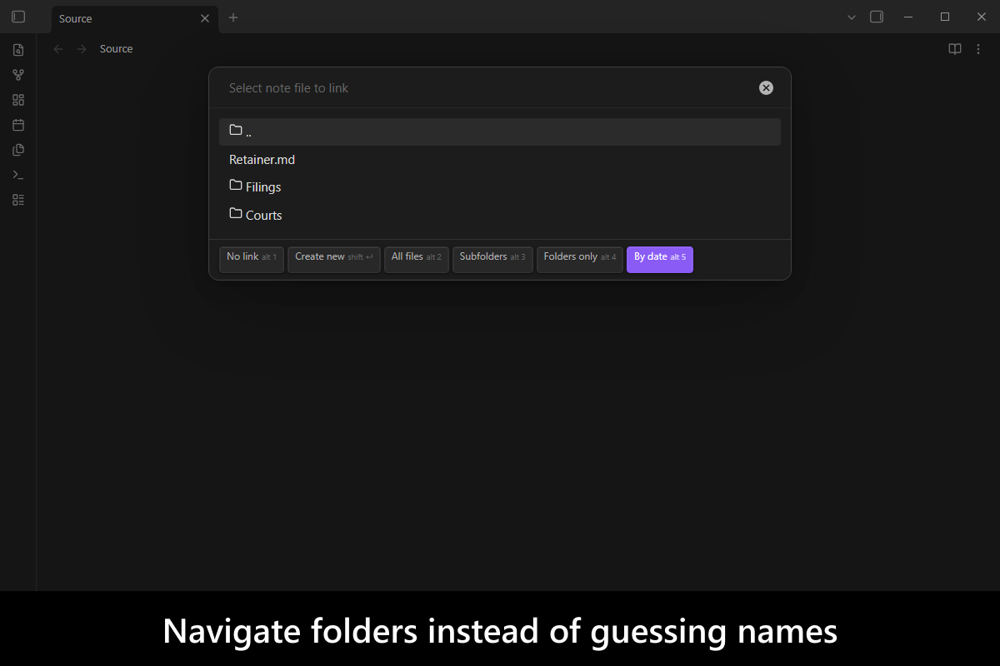
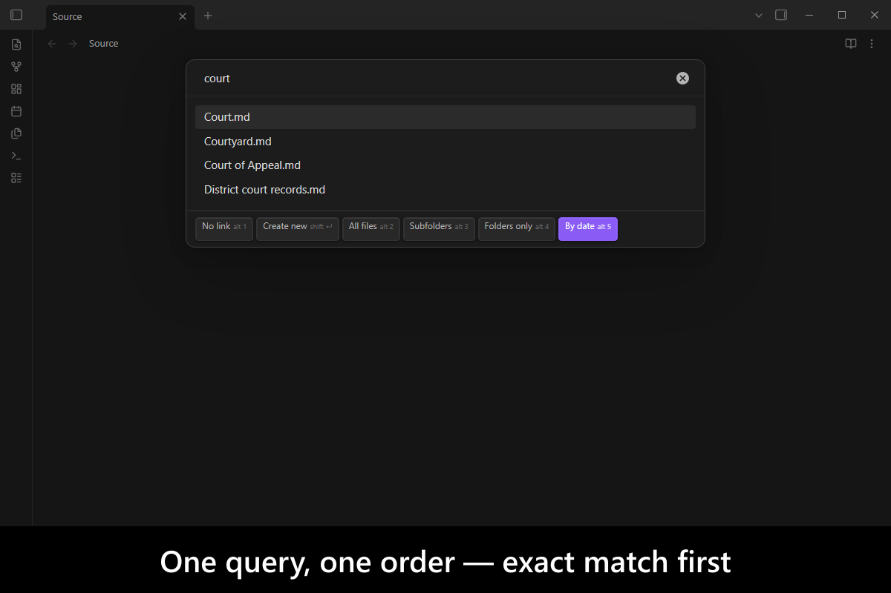
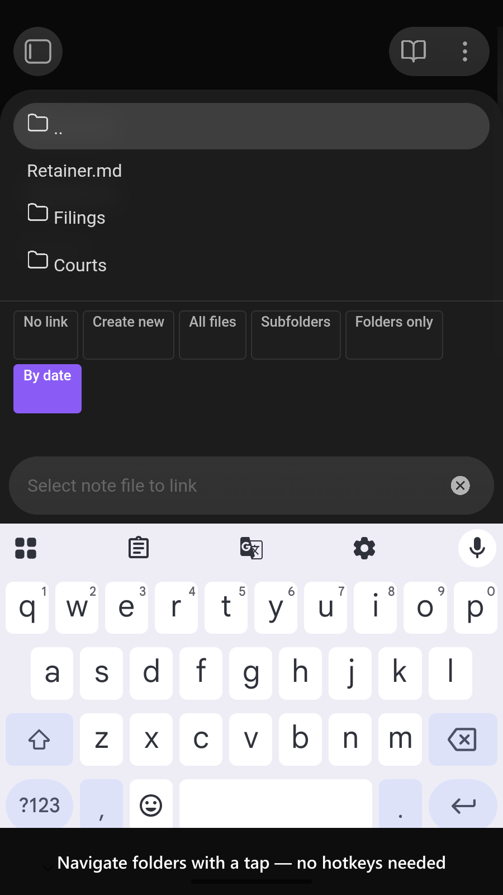
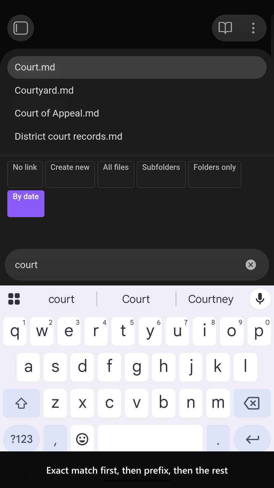

# Link Picker

   

Obsidian's own link autocomplete searches the whole vault and ranks it fuzzily, which is exactly wrong when you know the link belongs in one folder and you want the same note to come first every time. This plugin is a link picker you can point at a folder and then **navigate** — pick a folder to descend into it, pick `..` to come back out — with a ranking that is deterministic rather than fuzzy: an exact name beats a prefix, which beats a path match, which beats a scattered word match.

It is also callable. The picker returns a **string**, so a template or a script can ask for a link and drop the answer straight into a property value.

<!-- markdownlint-disable MD033 -->

More screenshots

<!-- markdownlint-enable MD033 -->

## Demo vault

**The documentation is a demo vault.** Every feature has a note that explains what it does and how to try it.

**[Start reading here](<./demo-vault/00 Start.md>)** — it is plain markdown, so it works on GitHub with nothing installed.

A copy of the vault ships with every release. You can access it via any of the following:

1. Running the **`Link Picker`: Open demo vault** command.
2. Downloading `link-picker-demo-vault.zip` from the [Releases](https://github.com/mnaoumov/obsidian-link-picker/releases). It unzips into a single `link-picker-demo-vault-<version>` folder.
3. Browsing its source in [`demo-vault/`](./demo-vault/README.md) in this repository.

## What it does

- **Navigate instead of guessing** — pick a folder to descend into it and `..` to come back out, so the list is one folder's contents rather than the whole vault. [02 Navigating folders](<./demo-vault/02 Navigating folders.md>)
- **A ranking you can predict** — an exact name beats a prefix, which beats a path match, which beats a scattered one, so the same query puts the same note first every time. [03 Ranking](<./demo-vault/03 Ranking.md>)
- **Aliases and folder notes are names too** — a note aliased three ways offers three rows, and a folder's alias lives on its folder note, read from your existing [`folder-notes`](https://github.com/LostPaul/obsidian-folder-notes) setup rather than configured again here. [03 Ranking](<./demo-vault/03 Ranking.md>)
- **Named pickers** — a folder you link into constantly becomes its own command, already rooted there, with its own prefix, suffix and placeholder. [04 Named pickers](<./demo-vault/04 Named pickers.md>)
- **A control strip that works on a phone** — **No link**, **Create new** and four view toggles, each a button you tap and a hotkey you press, since a phone has no `Alt` key. [01 Picking a link](<./demo-vault/01 Picking a link.md>)
- **Callable from a template or a script** — the picker resolves with the link as a **string**, so the answer can drop straight into a property value instead of being typed at a cursor. [06 Calling it from a script](<./demo-vault/06 Calling it from a script.md>)
- **Settings** — folder-note location, excluded paths, `Fuzzy` segment matching and the frontmatter properties it reads. [05 Settings](<./demo-vault/05 Settings.md>)

## Picking a link

Run **`Link Picker`: Insert link...** in an editor. Any selected text seeds the query and is replaced by the link you choose. `Enter` on a folder descends into it, and `Enter` on `..` goes back up.

## See also

[My other Obsidian resources](https://github.com/mnaoumov/obsidian-resources)

| Plugin | Features | How `Link Picker` differs |
| --- | --- | --- |
| [`Alias Quick Switcher`](https://community.obsidian.md/plugins/alias-quick-switcher) (my plugin) | Opens notes; path-segment alias matching; folder-note aliases | Different action: inserts links; navigates by folder |
| [`Another Quick Switcher`](https://community.obsidian.md/plugins/obsidian-another-quick-switcher) | Configurable switchers; fuzzy search; preview; multi-select; directory filter; insert hotkey | Overlaps on picking; folder navigation with `..`; fixed ranking; script returns a link string |
| [`Auto Link Suggester`](https://community.obsidian.md/plugins/auto-link-suggester) | Inline name completion from selected folders; no opening brackets needed | Alternative interaction: command/script picker rather than inline completion |
| [`Journal Utils`](https://community.obsidian.md/plugins/journal-utils) | Mobile people/group/location pickers; updates related frontmatter lists | Broader targets: any folder; desktop/mobile; leaves properties to the caller |
| [`Linkr`](https://community.obsidian.md/plugins/linkr) | File/heading/block link builder; display text; embed toggle | Narrower targets: whole notes; adds folder navigation, named rooted pickers and an API |
| [`Path Picker`](https://community.obsidian.md/plugins/path-picker) | Rooted filesystem path picker; preview; files/directories outside the vault too | Narrower targets: vault notes; inserts Obsidian links rather than filesystem paths |

Last searched for similar plugins on 2026-10-26.

## For plugin developers

The picker is published as a cross-plugin API: `select(options)` resolves with the link as a string and rejects when the user dismisses the picker. Copy [`api.d.ts`](./api.d.ts), which depends on `obsidian` alone, and, to check payloads, [`api-contract.ts`](./api-contract.ts) beside it. The contract version is **`1.1.0`**, and it moves independently of the plugin's.

[Calling `Link Picker` from a plugin or a script](<./docs/api.md>) covers the files to copy, consuming it with or without `@mnaoumov/obsidian-lib`, and the options worth knowing before you design around it.

## Installation

The plugin is available in [the official Community Plugins repository](https://community.obsidian.md/plugins/link-picker).

### Beta versions

To install the latest beta release of this plugin (regardless if it is available in [the official Community Plugins repository](https://community.obsidian.md) or not), follow these steps:

1. Ensure you have the [BRAT plugin](https://community.obsidian.md/plugins/obsidian42-brat) installed and enabled.
2. Click [Install via BRAT](https://intradeus.github.io/http-protocol-redirector?r=obsidian://brat?plugin=https://github.com/mnaoumov/obsidian-link-picker).
3. An Obsidian pop-up window should appear. In the window, click the `Add plugin` button once and wait a few seconds for the plugin to install.

## Debugging

By default, debug messages for this plugin (id: `link-picker`) are hidden.

If you need to enable them refer to the [documentation](https://mnaoumov.dev/obsidian-lib/guides/debugging/).

## Changelog

All notable changes to this project will be documented in the [CHANGELOG](./CHANGELOG.md).

## Contributing

Contributions are welcome — see [CONTRIBUTING](./CONTRIBUTING.md) to get set up.

## Support

<!-- markdownlint-disable MD033 -->

<!-- markdownlint-enable MD033 -->

## License

© [Michael Naumov](https://github.com/mnaoumov/)
